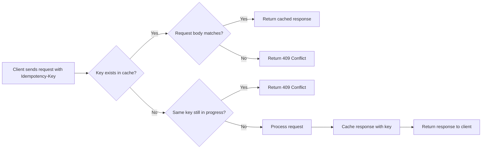

# Idempotency Keys

## Overview

Retry requests safely without duplicating operations using idempotency keys. This feature protects `POST`, `PUT`, and `PATCH` requests against duplicate operations caused by network issues, timeouts, or client retries.

## How It Works

The API processes idempotency keys in three steps:

1. Check if a response for that key exists in the cache
2. If cached, return the original response without re-executing the operation
3. If not cached and another request with the same key is still running, return 409 Conflict
4. Otherwise, process the request and cache the response for 1 hour



## Usage

Add the `Idempotency-Key` header to any `POST`, `PUT`, or `PATCH` request:

```yaml
POST /api/v1/companies/{company_id}/campaigns HTTP/1.1
---
Host: api.valentina-noir.com
Content-Type: application/json
X-API-KEY: your-api-key
On-Behalf-Of: user-uuid-here
Idempotency-Key: 550e8400-e29b-41d4-a716-446655440000

{
    "name": "My Campaign"
    ...
}
```

## Key Format

| Requirement | Details                                                                  |
| ----------- | ------------------------------------------------------------------------ |
| Type        | Unique string (UUID v4 recommended)                                      |
| Max Length  | 255 characters                                                           |
| Characters  | Visible ASCII only (`!` to `~`). No spaces, tabs, or control characters. |

A key that is too long or has a character that is not allowed returns a 400 Bad Request error. The `invalid_parameters` entry names the `Idempotency-Key` header. The API does not run the request.

## Supported Endpoints

All `POST`, `PUT`, and `PATCH` endpoints support idempotency. Include the `Idempotency-Key` header in your request to enable this feature.

!!! warning "API key endpoints"

    `POST /api/v1/developers/me/new-key` and `POST /api/v1/admin/developers/{developer_id}/new-key` ignore the `Idempotency-Key` header. Their responses contain a new API key, so the API never caches them. A retry of `/developers/me/new-key` after a successful call fails with `401`, because the old key it authenticates with was replaced. A retry of the admin endpoint generates another new key for that developer and invalidates the key from the first response.

!!! info "Naturally Idempotent Methods"

    `GET` and `DELETE` requests ignore the `Idempotency-Key` header because they are naturally idempotent.

## Body Validation

The API validates that request bodies match when reusing idempotency keys. Sending a request with the same key but different body returns a 409 Conflict error:

```json
{
    "status": 409,
    "title": "Conflict",
    "detail": "Idempotency key 'your-key' was previously used with a different request body. Each unique request must use a unique idempotency key.",
    "instance": "/api/v1/...",
    "request_id": "req_z5A6b7C8d9E0f1G2"
}
```

!!! warning "Unique Keys Required"

    Each unique operation must use its own idempotency key. The API prevents accidental key reuse with different request bodies.

## Access Checks

Before the API returns a cached response, it runs the endpoint's access checks again, the same way it checks a new request. These checks include your API key's access to the company and the `On-Behalf-Of` user's status and role. If the `On-Behalf-Of` user was deactivated, is no longer approved, or no longer has the role the endpoint requires, the API returns 403 Forbidden. If that user was archived or is no longer in the company, the API returns 404 Not Found. The API does not return the cached response in these cases.

## Concurrent Requests

The API runs only one request at a time for each idempotency key. If you send a request while an earlier request with the same key is still running, the API does not run the second request. It returns a 409 Conflict error:

```json
{
    "status": 409,
    "title": "Conflict",
    "detail": "A request with this idempotency key is still in progress.",
    "instance": "/api/v1/...",
    "request_id": "req_z5A6b7C8d9E0f1G2"
}
```

Wait, then retry with the same key and body. When the first request succeeded, the retry returns its cached response. When the first request failed, the retry runs again.

## Examples

### Python

```python
import uuid
import time
import requests


def create_campaign_with_retry(api_key, company_id, user_id, data, max_retries=3):
    """Create a campaign with automatic retry on server errors."""
    idempotency_key = str(uuid.uuid4())

    for attempt in range(max_retries):
        response = requests.post(
            f"https://api.valentina-noir.com/api/v1/companies/{company_id}/campaigns",
            headers={
                "X-API-KEY": api_key,
                "On-Behalf-Of": user_id,
                "Idempotency-Key": idempotency_key,
                "Content-Type": "application/json",
            },
            json=data,
        )

        if response.status_code < 500:
            return response

        # Server error - safe to retry with same idempotency key
        time.sleep(2**attempt)

    return response
```

### JavaScript

```javascript
async function createCampaign(apiKey, companyId, userId, data) {
    const idempotencyKey = crypto.randomUUID();

    const response = await fetch(
        `https://api.valentina-noir.com/api/v1/companies/${companyId}/campaigns`,
        {
            method: "POST",
            headers: {
                "X-API-KEY": apiKey,
                "On-Behalf-Of": userId,
                "Idempotency-Key": idempotencyKey,
                "Content-Type": "application/json",
            },
            body: JSON.stringify(data),
        },
    );

    return response.json();
}
```

## Best Practices

1. **Generate unique keys** - Use UUIDs or combine a client-generated ID with a timestamp
2. **Store keys client-side** - Keep the idempotency key until you receive a successful response
3. **Reuse keys only for retries** - Use the same key only when retrying the exact same request
4. **Avoid key reuse** - Each unique operation needs its own key (enforced with 409 errors)
5. **Set retry limits** - Implement exponential backoff with a maximum retry count
